# ChainSight - Retail Demand & Inventory Analytics on real Walmart data (Data Analyst / Business Analyst portfolio project)

> **One line:** I took the real Kaggle **M5 (Walmart)** sales data - 3,049 items, 10 stores, 273 weeks - cleaned and validated it, measured demand and revenue KPIs in SQL and pandas, forecast weekly demand (simple baselines first, a small neural network only as a challenger) and ended with prioritised, evidence-labelled recommendations.

**Story:** raw data -> cleaning -> EDA -> KPI analysis -> inventory / demand insights -> forecasting (baselines vs a simple neural network) -> business recommendations.

> **Data note:** the data is **real**: Kaggle *M5 Forecasting - Accuracy* (Walmart US, 2011-01-29 to 2016-04-22). It is not committed here (Kaggle competition rules); see `README_SETUP.md` for how to download it. Every number below is produced by the code and written into this file by `src/10_render_docs.py` - nothing is typed by hand. M5 has **no inventory, stock-out, cost or lead-time data**, so service KPIs (fill rate, turnover, days of inventory) are **not** computed; the two sections that need a lead time are explicitly marked **assumption-based**.

---

## 1. Executive summary (the "so what" first)

| | |
|---|---|
| **Scale** | 65,596,652 units and **$187.36M** revenue (units x weekly price) over 273 full weeks, 3,049 items in 3 categories, 10 stores in 3 states |
| **Concentration** | 1,264 **A items** (41% of items) make 80% of revenue; the top 100 items are only 23% - a long, flat catalogue |
| **Growth** | Total weekly revenue grew 30% between 2012 and 2015, but the number of item-store series on sale grew 79%, so revenue per on-sale series fell 15%. Growth is consistent with a wider assortment rather than each item selling more (new items also tend to be smaller sellers, which on its own lowers the per-series average). |
| **Calendar drives demand** | FOODS sells 1.10x (CA) to 1.30x (WI) as much on SNAP days; Saturday is 1.40x the lowest weekday; HOBBIES_2 swings 0.63 index points over the year |
| **Intermittency** | 24% of listed item-store-weeks have zero sales; 553 slow C items (2.9% of revenue) are candidates for range review |
| **Forecasting verdict** | The MLP is only marginally better than the best baseline (Exp. smoothing) on test: WAPE 24.5% vs 25.0% (2.3% relative, but its worst random seed does not beat the baseline) - below the 5% bar we set before looking at test. Linear regression with the same features is worse than the baseline (26.1% vs 25.0%): the extra features alone do not help, only the non-linear model gets a small gain. **Final model: Exp. smoothing.** Nothing more complex beat it by the required 5% on dev, so the simple baseline stays. |
| **What the data cannot say** | Fill rate, stock-outs, turnover and days of inventory need stock data that M5 does not have; a zero-sales week cannot be told apart from a stock-out. The safety-stock numbers use an **assumed** 1-week lead time |

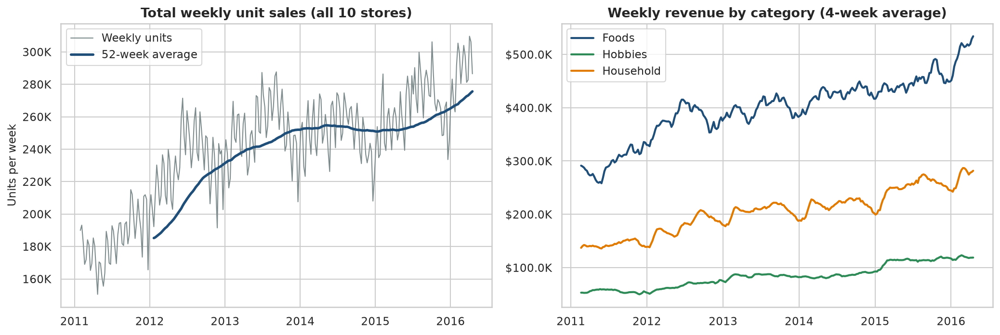

**Top recommendations** (full list with numbers in section 6):

1. Plan by ABC class and split the wide A group by demand variability.
2. Review the 553 slow C items for delisting or smaller footprint.
3. Put SNAP days, events and weekday patterns into replenishment plans, state by state.
4. Use **Exp. smoothing** for weekly forecasts; keep the neural network as a quarterly challenger.
5. Start recording stock-on-hand and stock-outs - the data gap is what stops service KPIs.

---

## 2. Problem and questions

A regional retailer sells 3,049 items through 10 stores. Management asks:

1. Which items and categories carry the business, and how concentrated is it (ABC)?
2. How does demand move - trend, seasonality, weekday, holidays, SNAP benefit days, price changes?
3. Which items are easy or hard to predict (variability, intermittency)?
4. What safety stock would a reorder policy need, *if* lead times were as assumed?
5. Can we forecast weekly demand better than simple rules - and is a neural network worth its complexity?

### What this data can and cannot answer

| Question | Answerable from M5? |
|---|---|
| Revenue, units, price, ABC, demand variability, intermittency | **Yes - measured** |
| Trend, seasonality, weekday, events, SNAP effect, price-cut association | **Yes - measured** (associations, not causal effects) |
| Forecast accuracy of baselines vs linear vs MLP | **Yes - measured** on a time-based hold-out |
| Safety stock / reorder point | **Only with an assumed lead time** (`config.py`) - labelled "assumption-based" everywhere |
| Fill rate, stock-out rate, turnover, days of inventory, supplier reliability, margin | **No** - M5 has no stock, cost or supplier data |

## 3. Dataset

Kaggle *M5 Forecasting - Accuracy* (Makridakis, Spiliotis, Assimakopoulos, "The M5 accuracy competition: Results, findings and conclusions", *International Journal of Forecasting*, 2022). Three raw files used (checksums so anyone can verify they have the same data):

| file | size_mb | md5 |
|---|---|---|
| calendar.csv | 0.10 | ee92c0916c0a7858d571feb429b08fd2 |
| sales_train_validation.csv | 120.00 | 26a366a25beb57b0a8f4c7b148758f94 |
| sell_prices.csv | 203.40 | 08c591caa99e55daf3e0ccac913f7c85 |

| Table | Grain | Rows (raw) |
|---|---|---|
| `sales_train_validation` | item x store, one column per day (wide) | 30,490 series x 1913 days |
| `sell_prices` | item x store x week | 6,841,121 |
| `calendar` | one row per day (weekday, month, events, SNAP flags) | 1,969 days |

There is no price for a week before an item's first listing: the zeros before launch are **not demand** and are masked (see 4.1). See `docs/DATA_DICTIONARY.md`.

## 4. Approach and key findings (each step ends with a "so what")

### 4.1 Cleaning and validation (`src/cleaning.py`, `notebooks/01_cleaning.ipynb`)
Honest finding: the real data is much cleaner than a typical business extract - no duplicates, no negatives, no missing sales. The work is **structural**: prove the data is what the documentation says, drop the 2 trailing days that do not make a full week, and **mask 21% of series-weeks** where the item had no price (not yet on sale), so they are not counted as zero demand. 1,119 week-to-week price changes above 3x and 1,026 demand spikes are *flagged, never deleted* (holiday peaks are exactly what a forecast must handle).

| table | rows_raw | cols_raw | rows_clean | note |
|---|---|---|---|---|
| sales (item-store x day) | 30,490 | 1913 | 30,490 | 65,695,409 units in the file; 65,596,652 in the 273 full weeks used |
| sell_prices (item-store x week) | 6,841,121 | 4 | 6,566,711 | rows inside the analysis window = on-sale series-weeks |
| calendar | 1969 | 14 | 1911 | days inside the analysis window |
| daily store x dept (derived) | 0 | 0 | 133,770 | aggregate used for weekday / SNAP / events |

**Independent check** (`src/verify_against_raw.py`): units and revenue were recomputed for each of the 10 stores straight from the raw files with a different method (long-format merge, none of the cleaning code). Units match for all stores: True; largest store-level revenue difference $0.00; total $187.36M.

*So what:* treating pre-launch zeros as demand would have made 21% of the history fake and pulled every average and forecast down; the full rule list is in `outputs/tables/cleaning_log.csv`.

### 4.2 EDA (`src/05_eda.py`, `notebooks/02_eda.ipynb`)

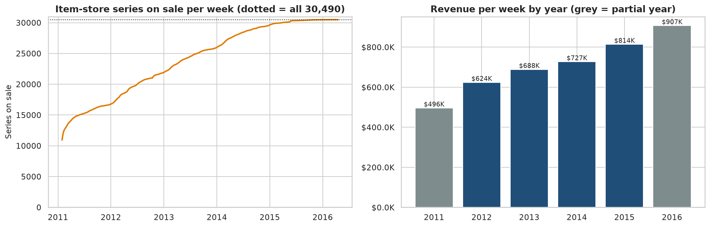

- **Growth and assortment.** Total weekly revenue grew 30% between 2012 and 2015, but the number of item-store series on sale grew 79%, so revenue per on-sale series fell 15%. Growth is consistent with a wider assortment rather than each item selling more (new items also tend to be smaller sellers, which on its own lowers the per-series average).
- **Mix:** FOODS 58% of revenue, HOUSEHOLD 30%, HOBBIES 12%; the biggest department is FOODS_3 (38%). CA is 45% of revenue; the largest store (CA_3) is 2.6x the smallest (CA_4).

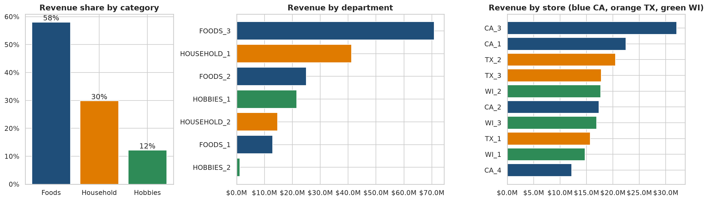

- **Seasonality** (complete years 2012, 2013, 2014, 2015): most seasonal department HOBBIES_2 (peak Oct 1.40, trough Jul 0.77); the three categories are far flatter (0.16 / 0.17 / 0.17 swing). **Weekday:** Saturday 1.23x vs Wednesday 0.88x.

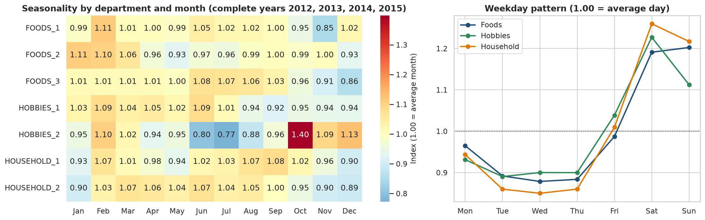

- **SNAP days and events:** FOODS units on SNAP days are 1.10x to 1.30x of other days (clearly state-dependent), other categories at most 1.04x. Events compared with the same weekday a week before and after: best LaborDay (1.28x), lowest Thanksgiving (0.74x). SNAP days fall early in the month, so part of that effect is the normal start-of-month pattern.

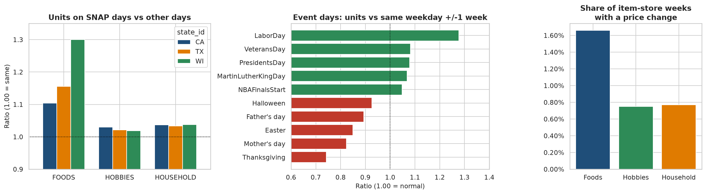

- **Intermittent demand:** 24% of listed item-store-weeks have no sale; at item x state level 18% of series have zero sales in over 20% of their weeks. By demand class: 80% smooth, 10% intermittent, 7% erratic, 2% lumpy.

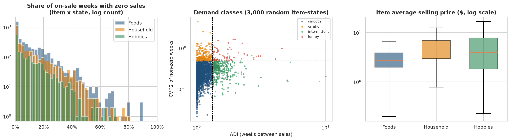

*So what:* one flat parameter per item cannot fit a business whose demand depends on the day of the week, the SNAP calendar, holidays and (for some departments) the season.

### 4.3 KPI analysis (`src/kpis.py`, `src/06_kpi_analysis.py`, `sql/`)

| KPI (measured) | Value |
|---|---|
| Units sold | 65,596,652 |
| Revenue (units x price) | $187.36M |
| Average selling price | $2.86 |
| Zero-sales share of listed item-store-weeks | 24.1% |
| Median weekly demand CV (item x state) | 0.60 (33% stable, 58% variable, 9% erratic) |

**ABC analysis** (A = first 80% of revenue, B = next 15%, C = the rest):

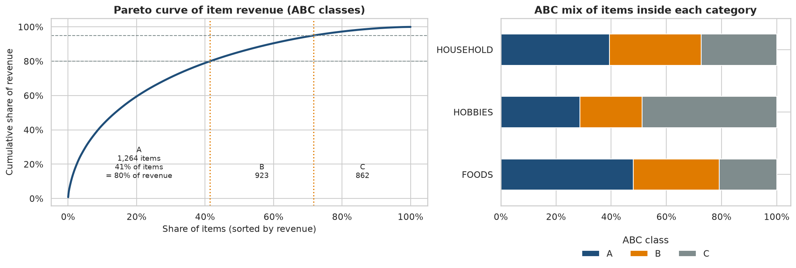

| abc_class | n_items | revenue | zero_week_share | items_share | revenue_share |
|---|---|---|---|---|---|
| A | 1264 | $149,913,864 | 15.5% | 41.5% | 80.0% |
| B | 923 | $28,093,238 | 24.2% | 30.3% | 15.0% |
| C | 862 | $9,351,351 | 36.7% | 28.3% | 5.0% |

A items sell in most weeks (15% zero-sales weeks) while C items often do not (37%). 553 C items (64% of C) are slow movers with only 2.9% of revenue. Within A, 41% of total revenue is stable demand, 36% variable and 4% erratic (ABC x variability matrix).

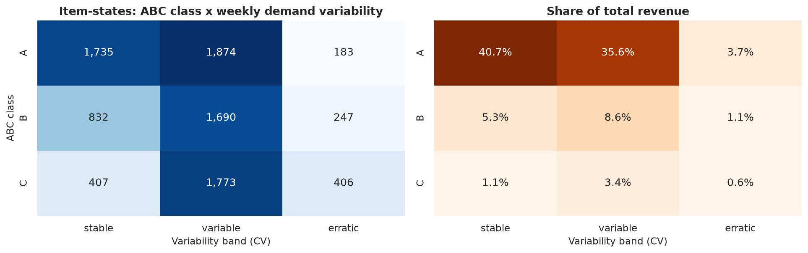

**Demand classes** (Syntetos-Boylan): 80% of item-state series are smooth and hold 87% of revenue; the 20% that are not smooth hold 13%.

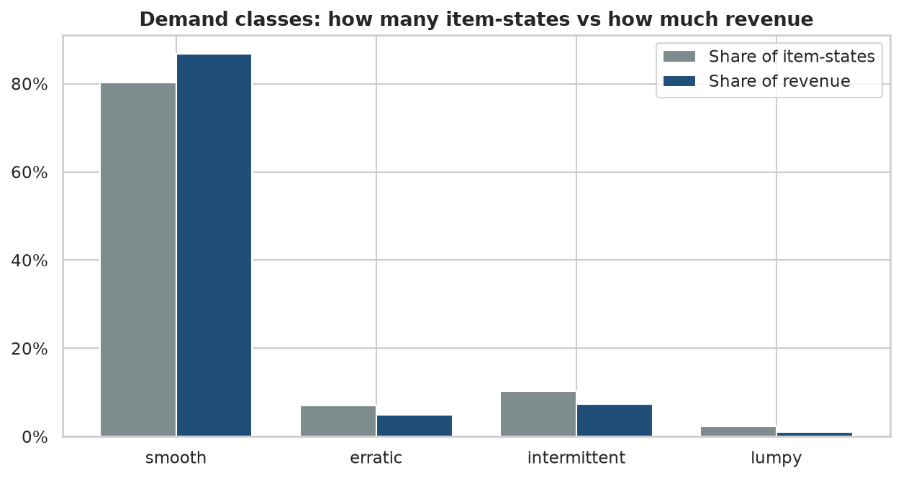

**Price cuts** (week price <= 90% of the previous 8-week average): they are rare (0.59% of weeks); a typical price-cut week sells more than the item's recent level (median 1.15x of the previous 8-week level vs 0.96x normally), but the mean is 2.81x because a few items jump a lot. This is an association, not a causal elasticity.

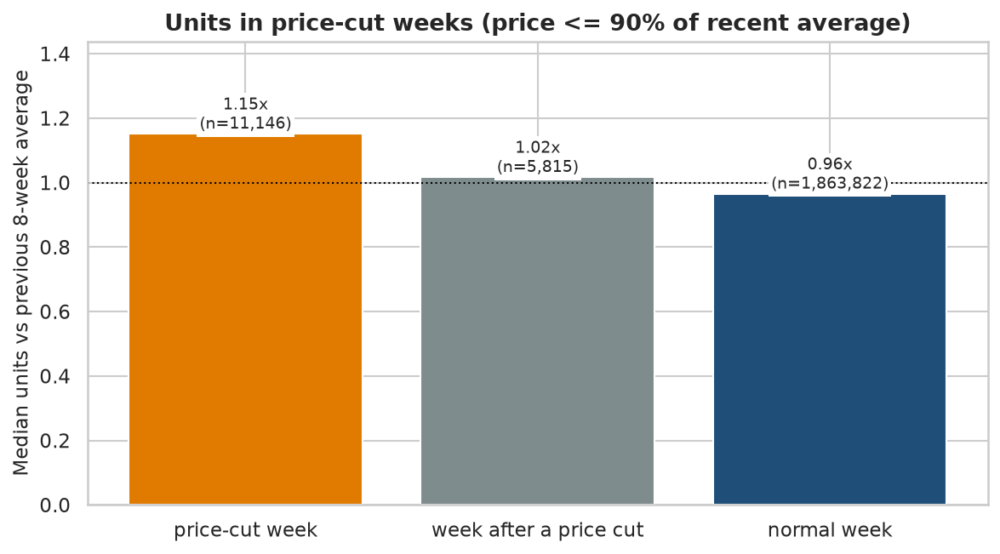

**Assumption-based safety stock** (formula `SS = z x sigma_weekly x sqrt(LT + R)`, `ROP = mean demand x LT + SS`; **assumed** LT = 1 week, R = 1 week, z = 1.65 ~ 95%). On the real weekly variability this implies $826K of safety stock at retail value for 9,147 item-state series (260,911 units, median cover 1.1 weeks). A items hold 71% of it, C items 10%; erratic series are 9% of series but 12% of the safety stock. Service targets by class (z = 1.88 / 1.65 / 1.28) change the total by 7.7%.

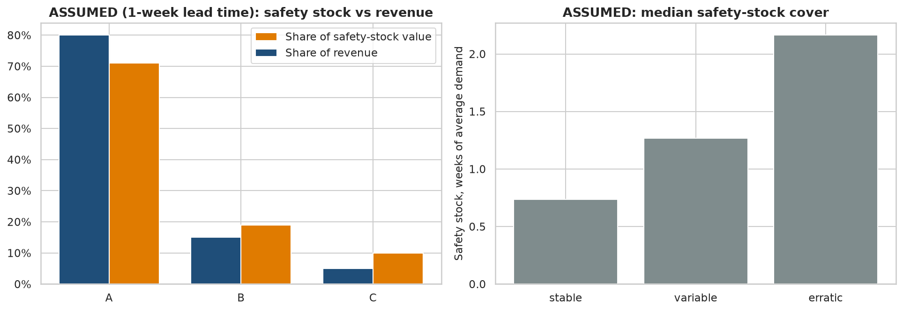

*So what:* where to spend planning effort (A items, variable and erratic series) is measurable; the dollar amounts depend on the lead-time assumption and are only a structure for the discussion until real lead times exist.

### 4.4 Forecasting (`src/07_forecasting.py`, `notebooks/04_forecasting.ipynb`)

**Setup.** Weekly demand at **item x state** level (9,136 series, what a regional distribution centre would forecast; 9 series with no sales in the train period are dropped). **Time-based split**: weeks 1-225 train (1,131,558 rows, 2012-01-28 to 2015-05-16), 226-249 dev (211,702), 250-273 test (217,886, 2015-11-07 to 2016-04-16); the test set is used once. Dev and test are consecutive recent blocks, but not identical: mean relative demand is 1.10 on dev vs 1.18 on test (demand trends upward); price-cut weeks are 0.4% of dev rows vs 0.3% of test rows. Forecast horizon: next week (one step ahead); a row needs 52 earlier on-sale weeks, so brand-new items are not forecast.
**Features** (known before the target week): lag 1/2/4/52, rolling mean 4/8, month (sin/cos), price ratio vs the previous 8 weeks, SNAP share of days, event flag. Each series is scaled by its train-period mean; features are standardised with train statistics only; model inputs and training targets are capped at the train 99.9% percentile (evaluation never is).
**Models:** Naive, Moving average (window 2), Exponential smoothing (alpha 0.6) - window/alpha chosen on dev; seasonal naive as a reference; linear regression; and an MLP written from scratch in NumPy (He init, ReLU, L2, mini-batch Adam, early stopping, gradient-checked in `tests/test_nn_gradcheck.py`). Selected MLP on dev: hidden (16, 8), L2 0.0001, dropout 0.0.
**Metrics:** the single optimising metric is **WAPE** (sum of absolute errors / sum of actual demand); satisficing metrics are RMSE (must not be worse than naive on dev), bias within +/-5%, and interpretability. The decision rule was fixed in advance: a more complex model must beat the best baseline by at least 5% on dev and be confirmed on test.

| model | WAPE_train | WAPE_dev | WAPE_test | RMSE_test | Bias_test | interpretable | passes_gates |
|---|---|---|---|---|---|---|---|
| Naive (last week) | 28.3% | 26.6% | 27.2% | 20.23 | -0.2% | Yes - one line | yes |
| Moving average | 27.6% | 25.8% | 26.2% | 20.66 | -0.6% | Yes - one line | no |
| Exp. smoothing | 26.3% | 24.9% | 25.0% | 19.49 | -0.6% | Yes - one parameter | yes |
| Seasonal naive (ref.) | 55.0% | 49.0% | 46.4% | 34.51 | -10.6% | Yes - one line | no |
| Linear regression | 26.5% | 26.1% | 26.1% | 20.10 | -1.8% | Yes - 11 coefficients | no |
| MLP (NumPy NN) | 24.9% | 24.2% | 24.5% | 19.09 | 0.7% | Partly - needs permutation importance | yes |

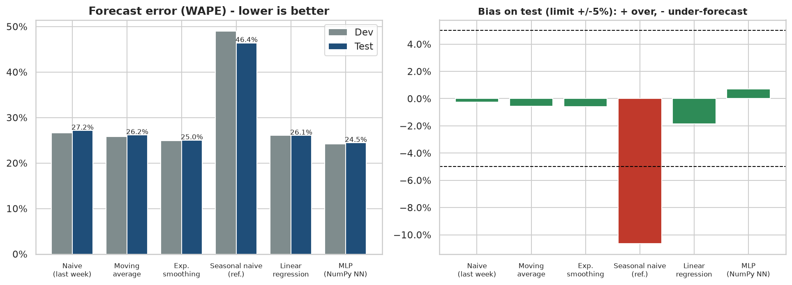

**Honest conclusion.** The MLP is only marginally better than the best baseline (Exp. smoothing) on test: WAPE 24.5% vs 25.0% (2.3% relative, but its worst random seed does not beat the baseline) - below the 5% bar we set before looking at test. Linear regression with the same features is worse than the baseline (26.1% vs 25.0%): the extra features alone do not help, only the non-linear model gets a small gain. The seasonal-naive reference (same week last year) scores 46.4% on test, far worse than the simple baselines: here recent weeks carry much more information than the same week a year ago (the 52-week lag ranks 8 of 11 in the MLP's permutation importance). The MLP passes both satisficing gates (|bias| <= 5% and RMSE no worse than naive). Over 5 random seeds its test WAPE ranges 24.5% - 25.4%. As an independent check, scikit-learn's `MLPRegressor` with the same architecture gets 24.8% on test, so the NumPy implementation is behaving. **Final model: Exp. smoothing.** Nothing more complex beat it by the required 5% on dev, so the simple baseline stays.

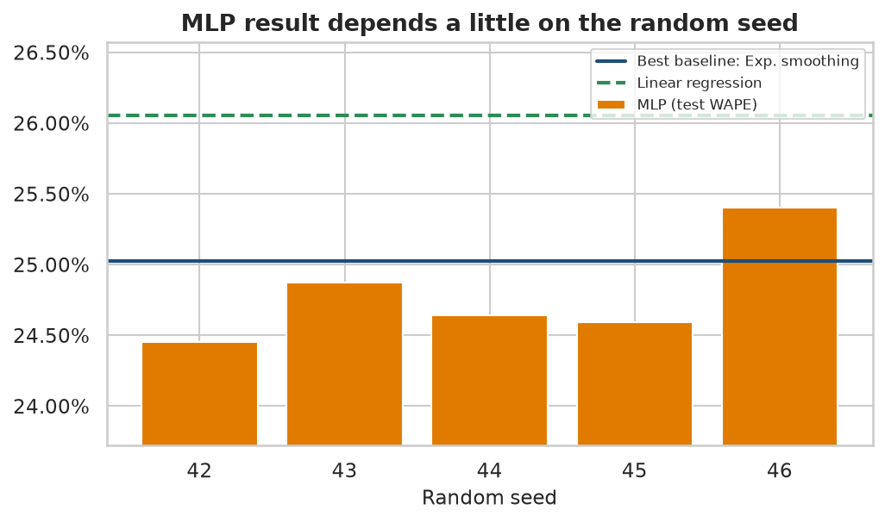

**Where the MLP helps.** On test it beats the best baseline in 8 of 9 category / state / ABC segments, and in the 571 price-cut rows its WAPE is 42.2% vs 49.4% - the known price is the one input the baselines ignore. Error is highest for C items (baseline 36.7%) and lowest for A items (21.7%).

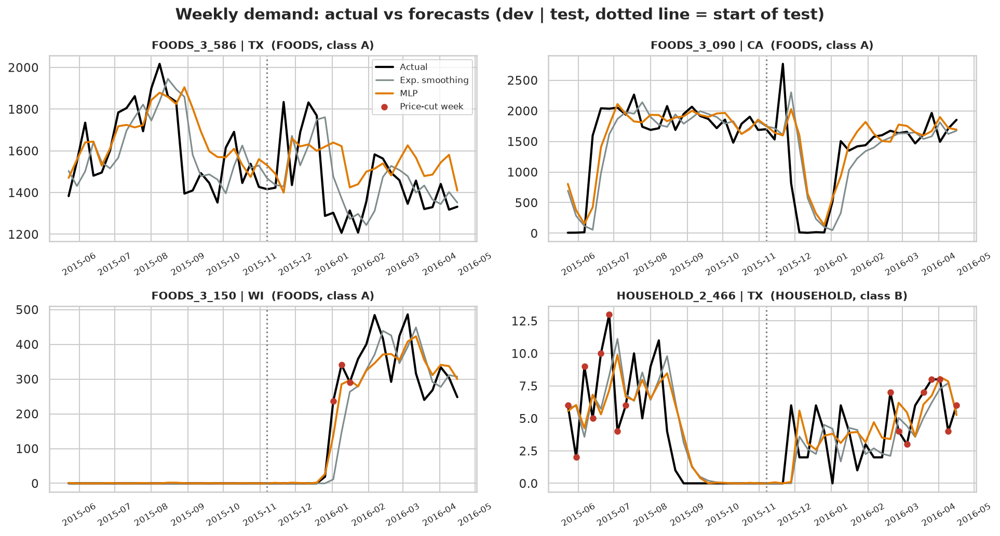

**Interpretability trade-off.** The linear model is read straight from its 11 coefficients; the MLP has 337 weights and can only be explained indirectly (permutation importance: 'lag_1' matters most, then 'roll_mean_4').

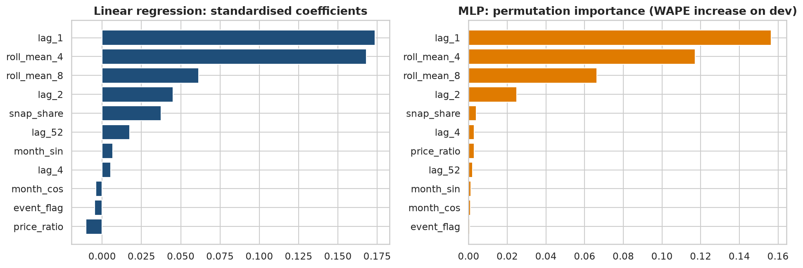

**Bias / variance diagnosis** (best baseline's train error is the "human-level proxy"): avoidable bias of the MLP = -1.4% (negative = it already beats the proxy on training weeks), variance = -0.7% (dev minus train error). The model already beats the baseline proxy on the training weeks and generalises: bias and variance are both small. Remaining error is likely noise or information these features do not contain.

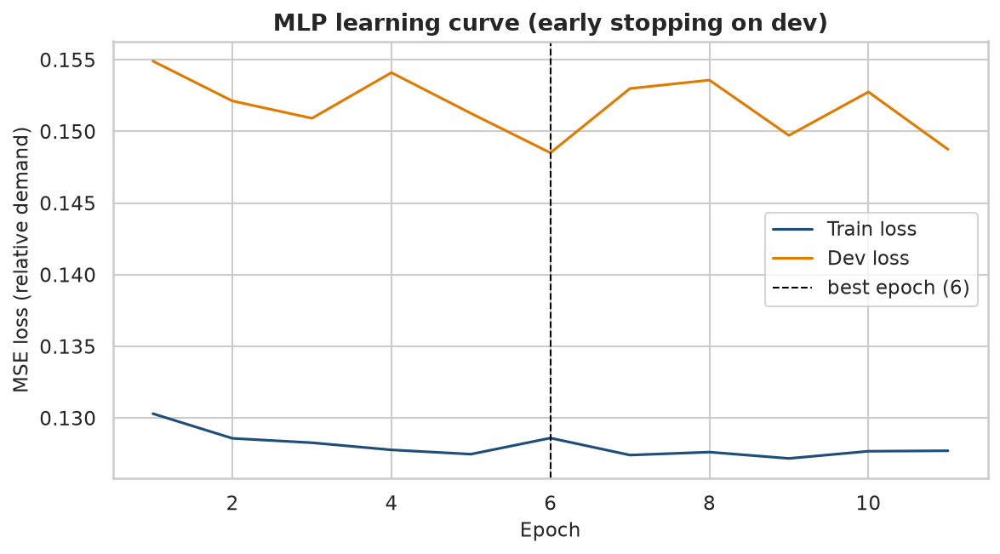

**Error analysis** (the 100 largest MLP errors on the dev set, which cover 2.5% of total dev error; full row-by-row table in `outputs/tables/error_analysis_top100.csv` with empty `manual_cause` / `notes` columns for you to fill in):

| primary_cause | n_errors | abs_error_units | under_forecast | share_of_errors | share_of_error_units |
|---|---|---|---|---|---|
| outlier_week | 79 | 32,172.52 | 38 | 79.0% | 81.9% |
| price_cut_week | 0 | 0.00 | 0 | 0.0% | 0.0% |
| post_price_cut_week | 0 | 0.00 | 0 | 0.0% | 0.0% |
| seasonal_turn | 0 | 0.00 | 0 | 0.0% | 0.0% |
| event_week | 8 | 2,773.77 | 1 | 8.0% | 7.1% |
| no_clear_cause | 13 | 4,339.74 | 7 | 13.0% | 11.0% |

The largest bucket is 'outlier week' with 79 of the top 100 errors (79%). But that tag is true for 29% of ALL dev rows, so among the big errors it is only 2.7x as common as normal; price-cut weeks are 10.0x over-represented (but only 4 rows). 46% of the big errors are under-forecasts. FOODS items are 98 of the 100; A-class items account for 98% of the big errors (they are the high-volume ones). The MLP beats the baseline on 47% of these rows. *So what:* the largest errors are weeks in which demand moved far from the previous 8-week level, and the calendar and price tags explain few of them. A lag-based model cannot see such jumps coming; the next step is to read these rows one by one (the `manual_cause` column) for causes the data cannot show, such as an item's own stock-out or a launch - not to build a bigger network.

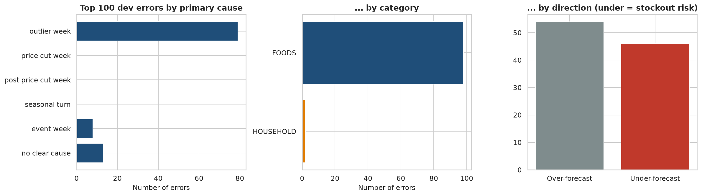

**What accuracy could be worth (simulation, assumption-based).** The data has no stock levels, so I replayed the real test-week demand through a weekly order-up-to policy with an **assumed** 1-week lead time and review period (`src/policy_sim.py`). To reach 95% fill it needs $557K of average inventory with the MLP forecast vs $646K with Exp. smoothing (13.7% less inventory). This is relative, not absolute: the replay treats observed sales as true demand (it cannot see lost sales) and uses the assumed lead time. Use it to frame a pilot, not to claim savings.

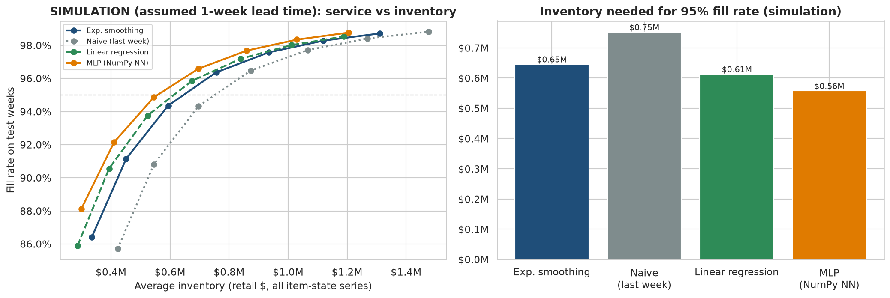

## 5. Repository structure

```
data/raw/        the 3 Kaggle M5 files (you download them; not in git)    data/processed/  cleaned panel, SQLite db (regenerated)
notebooks/       01 cleaning, 02 EDA, 03 KPIs, 04 forecasting, 05 recommendations
src/             numbered scripts 01..10 + library modules (panel, cleaning, kpis, features, baselines, nn_numpy ...)
sql/             schema + KPI, window-function, ABC, demand-variability, price/event, data-quality queries
outputs/         charts (PNG), tables (CSV), dashboard (CSV star schema + Excel), sql_results
tests/           pytest suite (tiny hand-made M5-style data)        docs/  data dictionary, data source, audit, templates
```

Setup and run order: **README_SETUP.md**. Interview preparation: **INTERVIEW_NOTES.md**.

## 6. Business recommendations 

_Evidence: **measured** = computed from the real M5 data; **assumption-based** = uses an assumed lead time (see config.py)._

### 1. Plan by ABC class: put the effort where the revenue is | Value at stake: $149.9M (revenue of A items, whole period)
_Evidence: measured_

**Finding:** 1,264 A items (41% of items) make 80% of revenue; the 862 C items (28%) make only 5%. The single best item (FOODS_3_586) is $1.5M, but the top 100 items are only 23% of revenue: this is a long, flat catalogue, not a handful of stars.

**Action:** Review A items weekly with a tight service target, B items every 2-4 weeks, and manage C items by exception. Because 'A' is a wide group here, split it again by demand variability (ABC x CV matrix) before setting stock rules.

**Track:** Revenue and zero-sales weeks by ABC class

### 2. Rationalise the slow tail | Value at stake: $5.3M (revenue of the slow C items (what a delisting would put at risk))
_Evidence: measured_

**Finding:** 553 C items (64% of all C items) are slow movers (no sale in more than 30% of their listed weeks) with only 2.9% of total revenue. C items have no sale in 37% of the weeks they are listed, vs 15% for A items.

**Action:** Review these slow C items for delisting or for a lower store footprint, and stock the rest to order-on-demand or larger, less frequent batches. Check first that they are not enablers (basket items) the data cannot show.

**Track:** Share of listed weeks with zero sales; revenue per listed item

### 3. Safety stock by item class (assumption-based) | Value at stake: $826K (safety stock at retail value (assumption-based))
_Evidence: assumption-based_

**Finding:** ASSUMPTION: 1-week lead time and review, 95% cycle service (config.py). On the real demand variability this implies about $826K of safety stock at retail value for 9,147 item-state series; A items hold 71% of it. Erratic series are 9% of series but need 12% of the safety stock (median cover 2.2 weeks vs 0.7 for stable series). Giving A / B / C different service targets (97% / 95% / 90%) changes the total by 7.7%.

**Action:** Replace one flat service factor by class- and variability-specific factors, and replace the lead-time assumption with real supplier lead times as soon as they are available.

**Track:** Safety-stock weeks of cover by class

### 4. Plan around the calendar: SNAP days, events, weekdays
_Evidence: measured_

**Finding:** In FOODS, SNAP benefit days lift units to 1.10x (CA) up to 1.30x (WI) of non-SNAP days; the effect on other categories is at most 1.04x. 4 of 26 named events sell at least 5% above normal neighbouring days (best: LaborDay, 1.28x) and 7 at least 5% below (lowest: Thanksgiving, 0.74x). Saturday is 1.40x the lowest weekday (Wednesday).

**Action:** Load the state-specific SNAP calendar, the event calendar and a weekday profile into replenishment and staffing plans, and build stock for FOODS ahead of SNAP days state by state.

**Track:** Units on SNAP vs non-SNAP days by state

### 5. Seasonal stock planning
_Evidence: measured_

**Finding:** HOBBIES_2 swings 0.63 index points between its peak (Oct, 1.40) and low (Jul, 0.77) month; the three categories swing only 0.16 (FOODS), 0.17 (HOUSEHOLD) and 0.17 (HOBBIES) overall, with peaks in Jun, Sep and Feb.

**Action:** Apply monthly seasonal indices at department level instead of a flat yearly parameter, starting with the most seasonal department.

**Track:** Forecast bias by month

### 6. Price cuts: test before you scale
_Evidence: measured_

**Finding:** Price-cut weeks are rare (0.59% of item-state weeks). In those weeks the typical item sells 1.15x its previous 8-week average (normal weeks 0.96x) - but the mean is 2.81x, so the average is pulled up by a few items that jump a lot. This is an association: cuts may be timed with seasons and events.

**Action:** Run a controlled price test (similar stores, with and without the cut) before basing a stock-up rule on this uplift; when a cut is planned, add it to the forecast as a known input.

**Track:** Unit uplift in test vs control stores

### 7. Forecasting model choice
_Evidence: measured_

**Finding:** On the untouched test weeks the best baseline (Exp. smoothing) has WAPE 25.0%, linear regression 26.1% and the MLP 24.5%. The MLP is slightly better than the best baseline but misses the bar we set in advance (2.3% relative gain; required: 5%). Chosen model: Exp. smoothing.

**Action:** Use Exp. smoothing for weekly forecasts; keep the MLP as a challenger and re-test it each quarter, and look for new information (price plans, events, stock availability) rather than a bigger network.

**Track:** WAPE and bias, rolling

### 8. What forecast accuracy could mean for stock (simulation, assumption-based) | Value at stake: $88K (difference in average inventory (simulation))
_Evidence: assumption-based_

**Finding:** ASSUMPTION: 1-week lead and review period. In a replay of the real test weeks, a policy using the MLP forecast reaches 95% fill with $557K of average inventory vs $646K for the Exp. smoothing policy (-13.7% change). That is a bigger gap than the 2.3% WAPE gap, because safety stock follows the spread of forecast errors (retail-value weighted, the MLP's spread is 7.6% lower). Treat it as indicative, not as a result: it depends on the assumed lead time and on observed sales being true demand (lost sales are invisible).

**Action:** Do not switch models on this alone. If a pilot with real stock and lead-time data shows a similar gap, the MLP's small accuracy edge would be worth its extra effort.

**Track:** Inventory needed for a target fill rate

### 9. Close the data gap: record stock and stockouts
_Evidence: measured_

**Finding:** 21% of item-store-weeks have no price (item not yet on sale); 24% of listed weeks have zero sales, and with no stock-on-hand data a zero cannot be told apart from a stockout. So fill rate, turnover and days of inventory cannot be measured from this data.

**Action:** Capture weekly on-hand stock, stockout flags, purchase prices and supplier lead times next to the sales data; with them the service and inventory KPIs become measurable.

**Track:** Share of sales rows with stock-on-hand recorded


## 7. Limitations

- **No inventory, cost or lead-time data.** Fill rate, stock-outs, turnover, days of inventory and margin cannot be measured. Revenue is units x list price (no discounts at the till, no cost).
- **Sales are not demand.** If an item is out of stock the sale is lost and invisible; a zero-sales week is not necessarily zero demand (see the 4-week collapse and recovery of one top item in the actual-vs-forecast chart).
- **Assumption-based sections** (safety stock, policy simulation) depend on the assumed lead time and review period in `config.py`; treat the dollar values as structure, not findings.
- **One-step-ahead forecasts at item x state level.** Replenishment needs lead-time-ahead forecasts, and store-level series are more intermittent than the state level used here.
- **Single hold-out.** One 24-week test window (time-based, used once); dev and test are not identical (demand trends upward), so dev and test WAPE are not strictly comparable. Brand-new items (under 52 weeks of history) are not forecast.
- **Associations, not causes.** SNAP, event and price-cut effects are observational; cuts may be timed with seasons and events.
- **Small neural network, modest data** (1,131,558 training rows): results vary a little by seed (range shown above).
- **One retailer, 2011-2016, US.** Patterns may not transfer.

